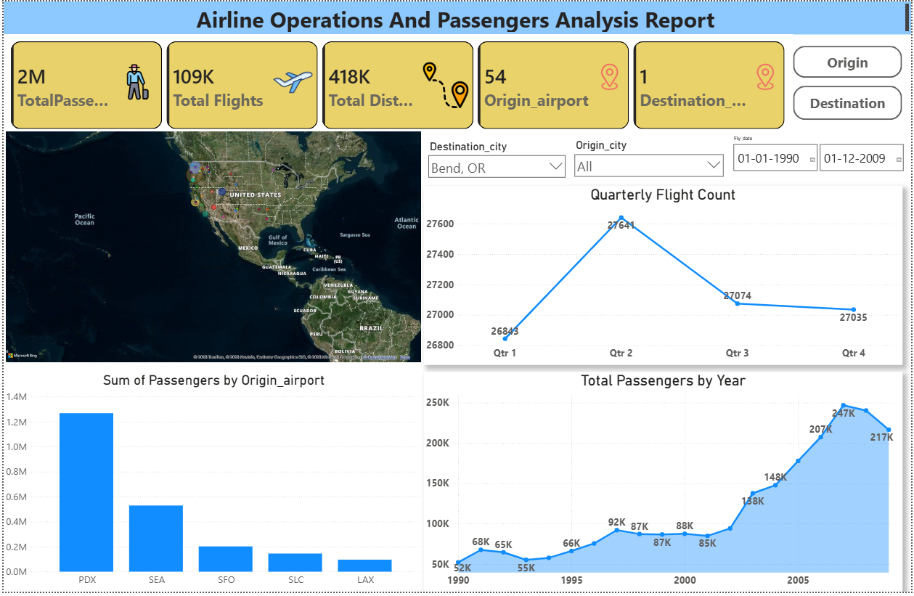

# ✈️ Airport Flight & Route Operations SQL Analytics

[](https://en.wikipedia.org/wiki/SQL)
[](https://www.mysql.com/)
[](#key-business-questions--sql-solutions)
[](https://github.com/akshat02812upadhayay-jpg)

An end-to-end SQL analytics project analyzing airline flight schedules, passenger demand, capacity utilization, route profitability, and year-over-year (YoY) trends from an airport management database.

---

## 📌 Executive Summary

Modern airline and airport operations generate extensive transactional data encompassing flight routes, seat capacities, ticket volumes, and flight dates. This project conducts an in-depth exploratory and diagnostic SQL analysis to extract actionable business insights that help airline network planners, airport authorities, and operations managers optimize:

1. **Route Capacity & Seat Utilization**: Identifying underperforming routes with poor load factors vs. saturated high-demand corridors.
2. **Fleet & Fuel Reach**: Analyzing total distance flown per origin airport to assist in fuel forecasting and aircraft assignment.
3. **Seasonality & Demand Fluctuations**: Uncovering peak and lean travel months to align staffing and gate management.
4. **Year-over-Year (YoY) Growth Trends**: Tracking passenger volume and flight volume trajectory across multiple operating years.

---

## 🗄️ Database Schema & Data Dictionary

The analysis is performed against the `airport_db.airports` dataset containing granular route and operational metrics:

| Column Name | Data Type | Description |
|---|---|---|
| `Origin_airport` | `VARCHAR` | 3-letter IATA code of origin airport (e.g., LAX, JFK, ORD) |
| `Destination_airport` | `VARCHAR` | 3-letter IATA code of destination airport |
| `Origin_city` | `VARCHAR` | Name of the departure metropolitan area |
| `Destination_city` | `VARCHAR` | Name of the arrival metropolitan area |
| `Passengers` | `INT` | Total passengers transported on the route |
| `Seats` | `INT` | Total seating capacity deployed |
| `Flights` | `INT` | Number of scheduled/completed flights |
| `Distance` | `INT` | Flight route distance in miles |
| `Fly_date` | `DATE` | Flight date (used for temporal and seasonal analytics) |
| `Origin_population` | `BIGINT` | Population of the originating city/market |
| `Destination_population` | `BIGINT` | Population of the destination city/market |
| `Org_airport_lat/long` | `DECIMAL` | Geospatial coordinates of origin airport |
| `Dest_airport_lat/long` | `DECIMAL` | Geospatial coordinates of destination airport |

---

## 🛠️ Advanced SQL Techniques Demonstrated

- **Aggregation & Statistical Summaries**: Multi-dimensional `GROUP BY`, conditional sums, weighted averages.
- **Data Hygiene & Zero-Division Safety**: Utilization of `NULLIF(seats, 0)` to prevent runtime divide-by-zero exceptions.
- **Filtering on Aggregations**: `HAVING` clauses for capacity threshold analysis (`<= 50%` load factor).
- **Common Table Expressions (CTEs)**: Multi-step analytical pipelines using `WITH` clauses for clean, readable code.
- **Window Functions**:
  - `LAG()` for calculating previous-period baselines and Year-over-Year (YoY) percentage changes.
  - `ROW_NUMBER() OVER (PARTITION BY ... ORDER BY ...)` for identifying yearly peak and trough traffic months.
- **Temporal Parsing**: `YEAR()`, `MONTH()`, and date partitioning for seasonal cohorting.

---

## 📊 Key Business Problems & SQL Solutions

### 1. Route Passenger Density & High-Traffic Corridors
* **Business Objective**: Identify the highest-volume airport pairs to assist airlines in allocating high-capacity widebody aircraft.
```sql
SELECT 
    Origin_airport,
    Destination_airport,
    SUM(Passengers) AS total_passengers
FROM airports
GROUP BY Origin_airport, Destination_airport
ORDER BY total_passengers DESC;
```

---

### 2. Seat Utilization & Load Factor Analysis
* **Business Objective**: Calculate average seat utilization (`(Passengers / Seats) * 100`) to highlight flights with optimal occupancy vs. empty seat waste.
```sql
SELECT 
    Origin_airport,
    Destination_airport,
    AVG(Passengers / NULLIF(Seats, 0)) * 100.0 AS avg_seat_utilization
FROM airports
GROUP BY Origin_airport, Destination_airport
ORDER BY avg_seat_utilization DESC;
```

---

### 3. Underutilized Route Detection (Low Load Factor Alert)
* **Business Objective**: Filter routes operating at $\le 50\%$ capacity to identify routes requiring schedule downsizing, promotional pricing, or cancellation.
```sql
SELECT 
    Origin_airport,
    Destination_airport,
    SUM(Passengers) * 1.0 / NULLIF(SUM(Seats), 0) AS passenger_to_seats_ratio
FROM airports
GROUP BY Origin_airport, Destination_airport
HAVING passenger_to_seats_ratio <= 0.5
ORDER BY passenger_to_seats_ratio ASC;
```

---

### 4. Peak vs. Lean Seasonality Detection via Window Functions
* **Business Objective**: Identify each year's single busiest and slowest operating month using analytical ranking functions.
```sql
WITH flight_details AS (
    SELECT 
        YEAR(Fly_date) AS year, 
        MONTH(Fly_date) AS month,
        SUM(Flights) AS total_flight_count,
        ROW_NUMBER() OVER (PARTITION BY YEAR(Fly_date) ORDER BY SUM(Flights) DESC) AS Max_count,
        ROW_NUMBER() OVER (PARTITION BY YEAR(Fly_date) ORDER BY SUM(Flights) ASC) AS Min_count
    FROM airports
    GROUP BY YEAR(Fly_date), MONTH(Fly_date)
)
SELECT 
    year,
    month,
    total_flight_count
FROM flight_details
WHERE (Max_count = 1 AND Min_count = 12)
   OR (Max_count = 12 AND Min_count = 1)
ORDER BY year DESC, total_flight_count DESC;
```

---

### 5. Year-over-Year (YoY) Route Passenger Growth Rate
* **Business Objective**: Measure route expansion velocity by comparing current passenger totals against prior-year figures using `LAG()`.
```sql
WITH passenger_details AS (
    SELECT 
        Origin_airport,
        Destination_airport,
        YEAR(Fly_date) AS year,
        SUM(Passengers) AS total_passenger,
        LAG(SUM(Passengers)) OVER (
            PARTITION BY Origin_airport, Destination_airport 
            ORDER BY YEAR(Fly_date)
        ) AS pre_year_passenger
    FROM airports
    GROUP BY Origin_airport, Destination_airport, YEAR(Fly_date)
)
SELECT 
    Origin_airport,
    Destination_airport,
    year,
    CASE 
        WHEN pre_year_passenger IS NOT NULL THEN
            CONCAT(ROUND(((total_passenger - pre_year_passenger) * 100.0 / NULLIF(pre_year_passenger, 0)), 2), '%')
        ELSE NULL 
    END AS growth_percent 
FROM passenger_details
ORDER BY Origin_airport, Destination_airport, year DESC;
```

---

### 6. Macro Annual Flight & Passenger Growth Trajectory
* **Business Objective**: Synthesize macro-level network performance by calculating total annual flights, passengers, and annual growth percentages.
```sql
WITH Yearly_Summary AS (
    SELECT 
        YEAR(Fly_date) AS Year, 
        COUNT(Flights) AS Total_Flights,
        SUM(Passengers) AS Total_Passengers
    FROM airports
    GROUP BY YEAR(Fly_date)
),
Yearly_Growth AS (
    SELECT 
        Year,
        Total_Flights,
        Total_Passengers,
        LAG(Total_Flights) OVER (ORDER BY Year) AS Prev_Flights,
        LAG(Total_Passengers) OVER (ORDER BY Year) AS Prev_Passengers
    FROM Yearly_Summary
)
SELECT 
    Year,
    Total_Flights,
    Total_Passengers,
    ROUND(((Total_Flights - Prev_Flights) / NULLIF(Prev_Flights, 0) * 100), 2) AS Flight_Growth_Percentage,
    ROUND(((Total_Passengers - Prev_Passengers) / NULLIF(Prev_Passengers, 0) * 100), 2) AS Passenger_Growth_Percentage
FROM Yearly_Growth
ORDER BY Year;
```

---

## 📸 Query Execution Preview

Query execution and output validation screenshot from SQL Workbench / Client:



---

## 💡 Strategic Business Takeaways

1. **Capacity Rationalization**: Routes flagged with $<50\%$ load factors represent direct operational cost drains. Reassigning smaller regional aircraft to these routes can immediately improve profit margins.
2. **Hub Connectivity**: Origin hubs with the highest total flight frequencies require specialized gate and ground crew prioritization during peak summer travel periods.
3. **Fuel & Long-Haul Planning**: Distance aggregations pinpoint long-haul corridors that are most vulnerable to jet fuel price volatility, signaling where hedging strategies are needed.

---

## 🚀 How to Run the Project

### Prerequisites
- Any SQL RDBMS installed (MySQL 8.0+, PostgreSQL, SQLite, or cloud warehouse).
- A SQL IDE (MySQL Workbench, DBeaver, VS Code SQLTools, or CLI).

### Steps
1. **Clone the repository**:
   ```bash
   git clone https://github.com/akshat02812upadhayay-jpg/Airport-SQL-Analysis.git
   cd Airport-SQL-Analysis
   ```

2. **Prepare Database**:
   ```sql
   CREATE DATABASE IF NOT EXISTS airport_db;
   USE airport_db;
   ```

3. **Execute Analysis**:
   - Open and run [airport_sql_project.sql](airport_sql_project.sql).
   - Queries are structured sequentially from foundational aggregations (Problems 1–5) to intermediate filtering (Problems 6–10) and advanced analytical window functions (Problems 11–13).

---

## 👤 Author

- **Akshat Upadhayay**
  - GitHub: [@akshat02812upadhayay-jpg](https://github.com/akshat02812upadhayay-jpg)
  - Project: [Airport SQL Analysis](https://github.com/akshat02812upadhayay-jpg/Airport-SQL-Analysis)
